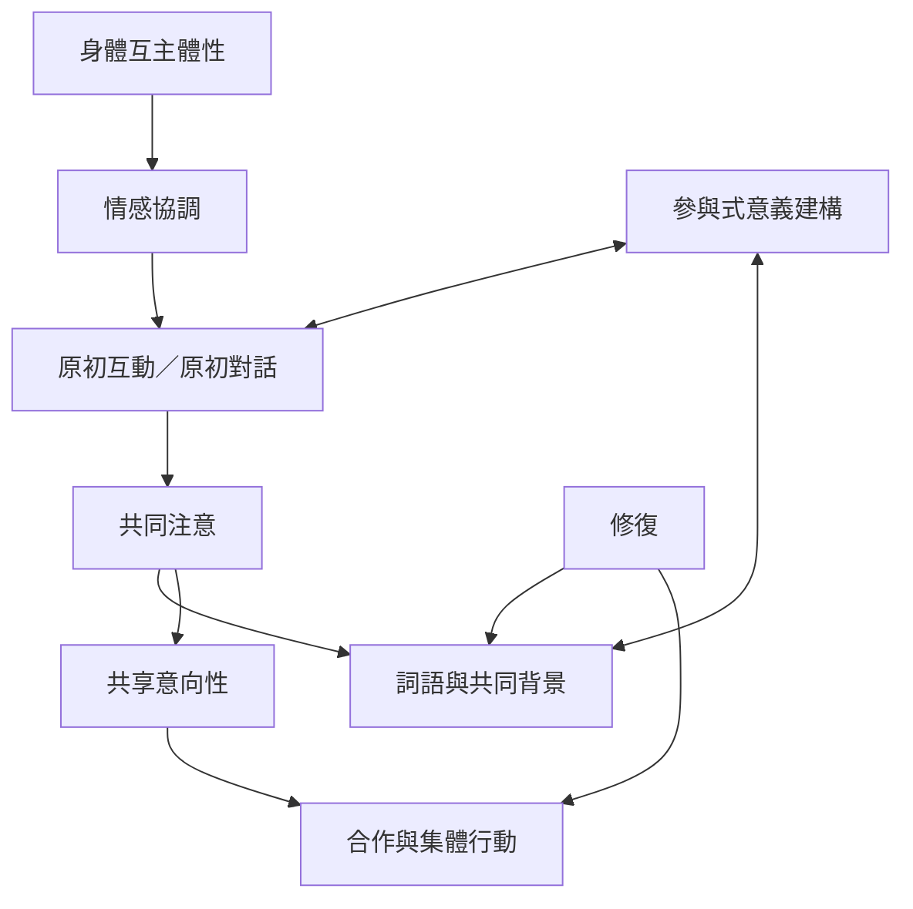

本圖整理從嬰兒早期情感互動到共同注意、語言與合作的發展路徑，也納入生成論對互動過程的強調。它不是單一路徑或普遍固定時序，而是提供跨研究比較的概念架構。

## 關係圖

## 參考
* 相關筆記：[[共同注意讓兩個人圍繞同一事物建立關係]]、[[互動過程本身會改變參與者能理解什麼]]、[[詞語的意義在共同使用與修正中形成]]、[[身體同步可能支持互動但不能證明彼此理解]]。
* 概念：[[身體互主體性]]、[[情感協調]]、[[共同注意]]、[[共享意向性]]、[[參與式意義建構]]、[[修復]]。
* 延伸地圖：[[生活世界、語言與共同理解如何生成]]。
