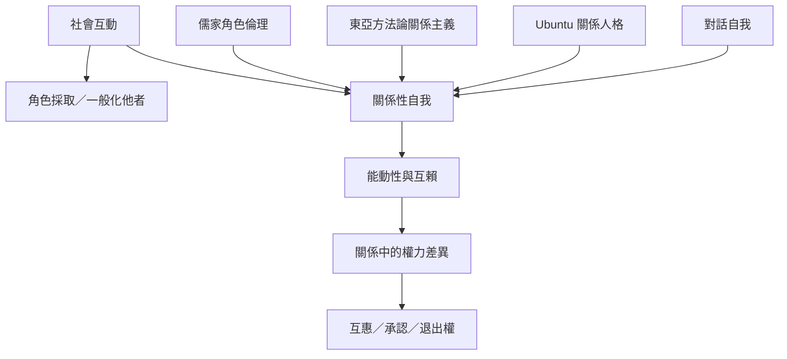

本圖比較美國實用主義、儒家關係倫理、東亞本土心理學、Ubuntu 與對話自我理論，討論自我如何在關係中成形。各傳統並不相同，圖中的連線表示可比較的問題，不表示概念等同。

## 關係圖

## 參考
* 相關筆記：[[自我透過採取他人角色逐漸形成]]、[[關係位置會限制也會提供行動可能]]、[[關係性人格觀不能抹除社群內部的差異]]、[[自我由多個社會位置與聲音構成]]。
* 概念：[[關係性自我]]、[[符號互動論]]、[[方法論關係主義]]、[[Ubuntu]]、[[對話自我理論]]。
* 延伸地圖：[[集體意向、承認與共同生活的政治面向]]。
