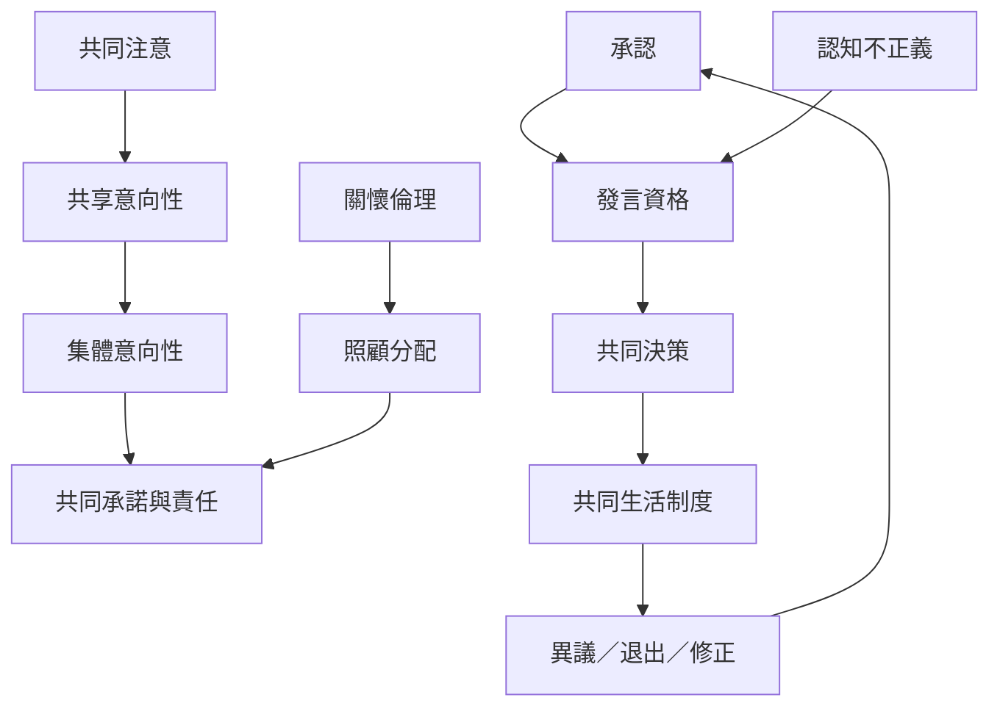

本圖把共同注意與共享意向，延伸至集體責任、承認、認知正義、照顧與公共決策。它指出共同生活既是認知與情感過程，也是權力、制度與資源分配問題。

## 關係圖

## 參考
* 相關筆記：[[共同在場不等於共同決策]]、[[集體責任需要可辨識的共同承諾]]、[[共同理解的失敗有時是權力造成而非能力不足]]、[[照顧是一種具身的共同實作]]、[[共同體的和諧可能掩蓋被排除者的聲音]]。
* 概念：[[集體意向性]]、[[共享意向性]]、[[承認]]、[[認知不正義]]、[[關懷倫理]]。
* 延伸地圖：[[互為主體性的哲學根基與倫理問題]]、[[關係性自我、文化與集體生活]]。
