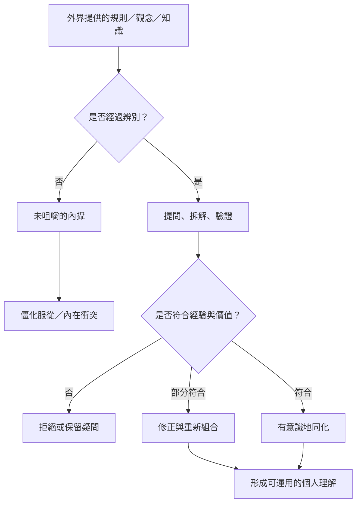

在完形治療中，內攝常被描述為未經辨別便吞下外界材料；同化則是理解、拆解、測試與重新組合。這張圖把「外來觀念」轉化為「可自行選擇的知識」的過程呈現出來。這是完形治療的特定用法，不能直接套用到所有精神分析文獻。

## 延伸連結
[[完形治療]]、[[內攝]]、[[內化]]、[[有意識地接受或拒絕比盲目服從更接近自主]]、[[完形治療把心理同化比喻為咀嚼消化與重新組合]]、[[先辨認心中的命令來自哪裡再決定是否接受]]。

總覽：[[Introjection]]
