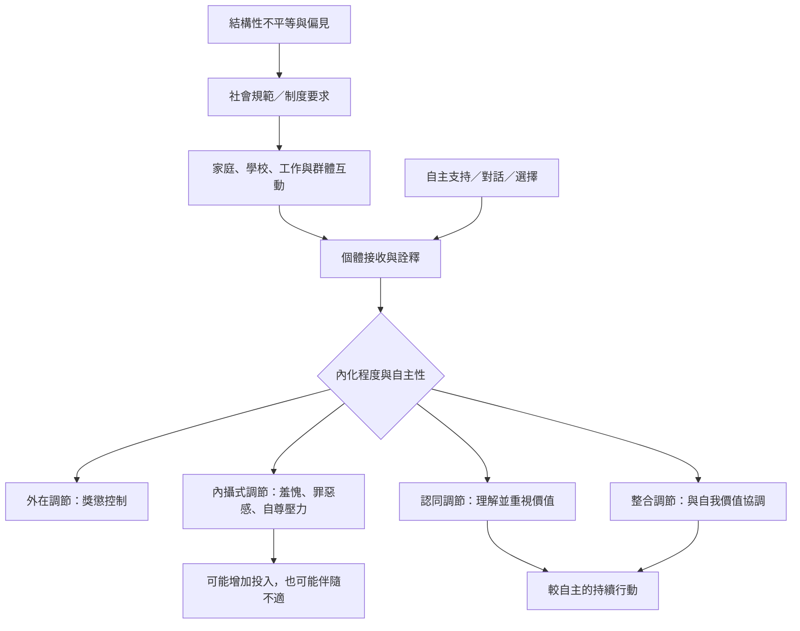

自我決定理論中的內攝式調節，指外在要求部分進入個體的自我調節，但仍伴隨內在壓力。文化心理學與批判研究則補充：規範本身從制度、關係與象徵資源而來。因此，理解內攝式動機，既要觀察個人感受，也要分析環境如何提供或強化規範。

## 延伸連結
[[自我決定理論]]、[[內攝式調節]]、[[認同調節]]、[[整合調節]]、[[內化壓迫]]、[[文化心理學]]、[[文化規範的內化必須放回制度關係與象徵資源理解]]、[[自主支持有助於把外在要求轉化為自我認同的價值]]。

總覽：[[Introjection]]
