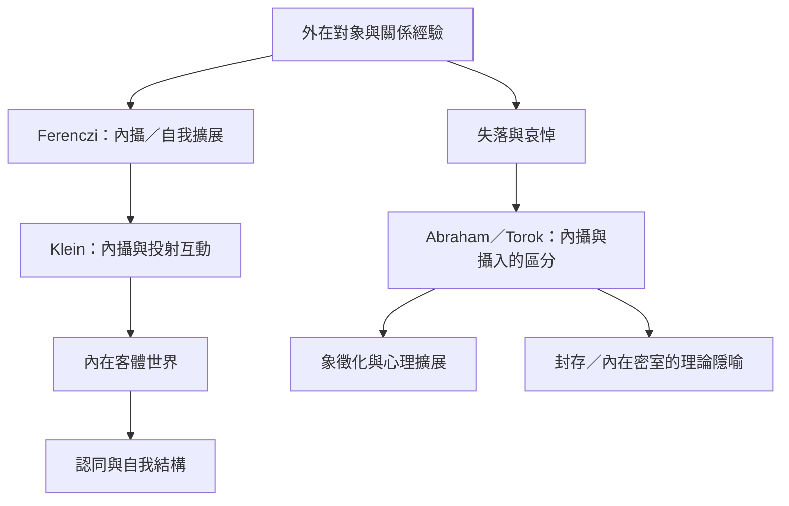

精神分析中的內攝，從 Ferenczi 對自我與外界關係的描述，發展到 Klein 對內在客體世界的理論，再到 Abraham 與 Torok 對內攝、攝入及哀悼的區分。這條脈絡不代表各作者提出同一套模型，而是呈現概念如何被重新界定。

## 延伸連結
[[內攝]]、[[投射]]、[[內在客體]]、[[認同]]、[[攝入]]、[[投射性認同]]、[[象徵化]]、[[內攝與投射共同塑造內在關係也影響外界知覺]]、[[內攝可擴展自我攝入則可能封存無法哀悼的失落]]。

總覽：[[Introjection]]
