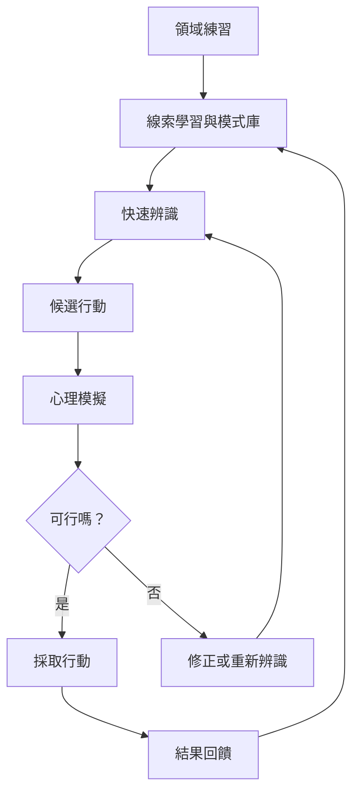

專家直覺的可靠性來自特定領域的經驗、穩定線索與回饋，而非抽象的「直覺力」。辨識導向決策說明專家如何先辨識模式、生成可行方案，再透過心理模擬和反思檢查。

核心筆記：[[直覺可信度取決於環境規律與回饋品質]]、[[專家直覺是長期學習後的壓縮辨識]]、[[直覺與分析是循環校準而非二選一]]、[[直覺的成熟表現在知道何時暫停]]。

概念連結：[[專業知識]]、[[識別導向決策]]、[[生態理性]]、[[默會知識]]、[[後設認知]]。
