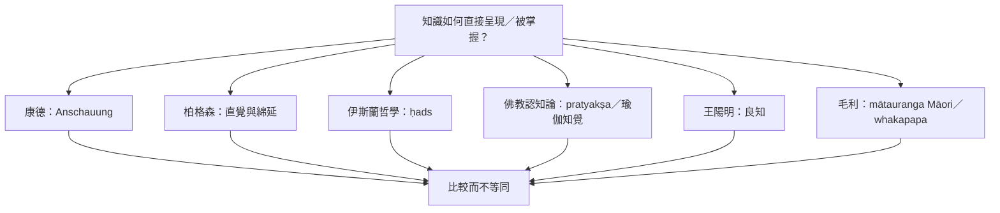

「直覺」在哲學與不同文化的知識實踐中並非單一概念。跨文化閱讀應保留原語、歷史、倫理、知識主體與世界觀，而不是把各傳統直接納入現代心理學的一個分類。

核心筆記：[[跨文化知識不可只用西方心理術語收編]]、[[哲學的直觀與心理學的直覺不能直接等同]]、[[Mātauranga Māori 是有自身世界觀的知識哲學]]、[[毛利感官方法以自然沉浸與共同反思生成知識]]、[[伊斯蘭哲學中的 ḥads 是非推論式直覺洞見]]。

概念連結：[[感性直觀]]、[[良知]]、[[Mātauranga Māori]]、[[Whakapapa]]、[[Ḥads]]、[[Pratyakṣa]]、[[Prajñā]]。
