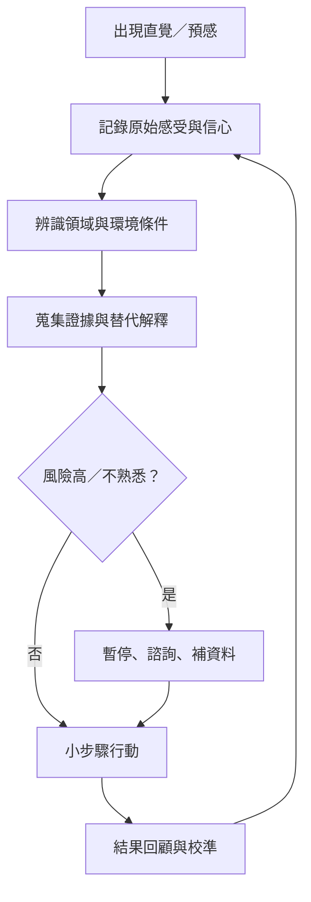

練習直覺不是追求更快相信自己，而是提升辨識、校準、覺察與修正能力。將直覺記錄下來，分清身體訊號和解釋，並在高風險決策中保留暫停空間，能讓直覺成為可負責任使用的資訊。

核心筆記：[[直覺判斷應以可修正性作為知識倫理]]、[[團體直覺需要多元位置與異議校準]]、[[直覺的成熟表現在知道何時暫停]]。

行動筆記：[[建立直覺日誌以檢驗預感而非只記得命中]]、[[把身體感受和對它的解釋分開記錄]]、[[散步後留白可讓問題線索重新組合]]、[[以冥想觀察衝動的生滅而非把它當指令]]、[[為重要決策建立直覺與證據雙軌流程]]、[[在熟悉技能中辨識專家直覺的身體線索]]、[[用群體回顧讓不同人的直覺互相校準]]、[[將直覺可靠度畫成情境地圖]]、[[以環境感官日誌練習關係性的地方感知]]、[[為高風險決策設立直覺暫停規則]]。

概念連結：[[後設認知]]、[[內感受]]、[[生態理性]]。
