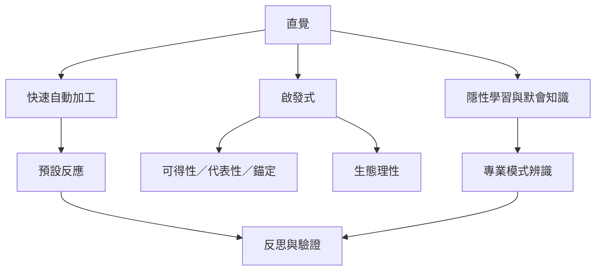

直覺不是單一能力，而是由多種快速加工、隱性學習、啟發式與領域模式辨識構成的家族。這張圖先把「快速加工」和「判斷結果」分開，再把啟發式的適應性與偏誤放在同一張地圖。

核心筆記：[[直覺不是第六感而是多種快速推斷的集合]]、[[快速自動加工提供預設判斷但不等於無誤]]、[[未被意識辨認的線索整合能形成直覺假設]]、[[啟發式讓判斷省力也可能製造系統偏誤]]、[[簡單啟發式的好壞取決於生態環境]]、[[直覺適合發現問題卻不能自行證成答案]]。

概念連結：[[雙歷程理論]]、[[隱性學習]]、[[默會知識]]、[[啟發式]]、[[可得性捷思法]]、[[代表性捷思法]]、[[錨定效應]]、[[辨識啟發式]]、[[識別導向決策]]、[[洞察]]、[[孵化效應]]。
