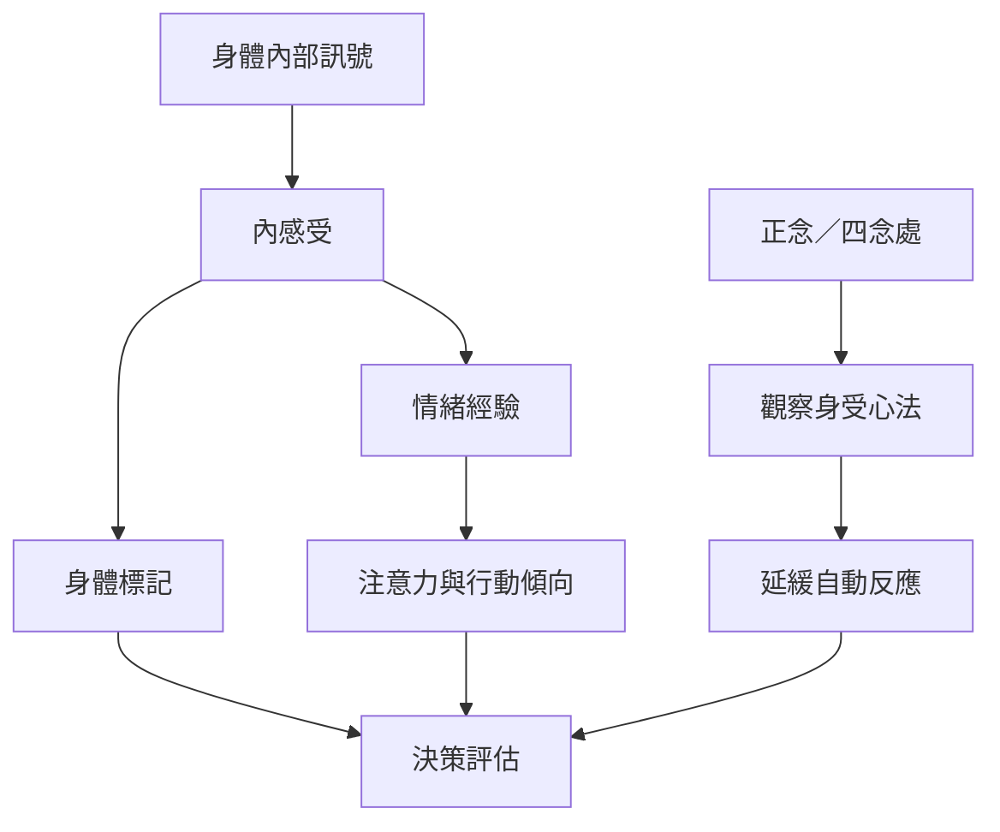

身體訊號是直覺判斷的可能來源之一，但訊號與解釋之間存在距離。內感受、情緒和注意力彼此影響；正念觀察則可以讓感受先成為覺察的對象，而不必立即成為行動命令。

核心筆記：[[身體訊號值得聆聽但不應服從]]、[[情緒改變顯著性而非直接揭示真相]]、[[注意力與覺察可將直覺從反應轉成觀察材料]]、[[四念處以持續觀照深化對身心現象的理解]]、[[正念與身體覺察相關但量化證據仍不確定]]。

概念連結：[[內感受]]、[[身體標記]]、[[情緒]]、[[後設認知]]、[[Prajñā]]、[[Pratyakṣa]]。
