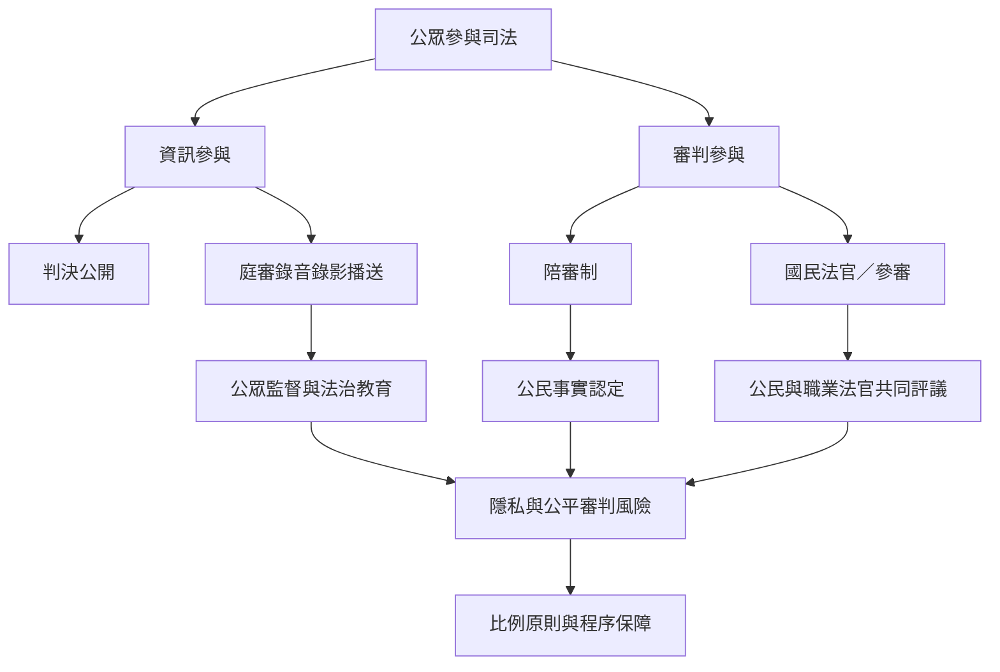

公民參與司法的方式包括旁聽、公開判決、法庭播送、陪審或參審制度及司法教育。每種工具改變的權力與風險不同，需要在知情權、審判公平、參與者安全及制度理解之間設計。

核心連結：[[法庭公開應追求可理解的透明而不是無限制曝光]]、[[公民參與審判必須明確配置法律與事實判斷權]]、[[司法透明不是無差別公開而是可受檢驗的權衡]]。

## 思與行
* 同時比較資訊公開與公民直接參與，避免把兩者都籠統稱為「司法透明」。
* 以當事人、被害人、證人與公眾不同立場設計制度評估。

## 參考
* [[臺灣2025年法庭公開播送規則採案件類型與權益衡量]]。
* [[法庭直播實驗顯示公開可能改變訴訟參與者的表達方式]]。
* [[國民法官法自2023年起讓一般公民參與特定刑事審判]]。
