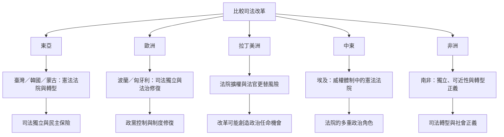

全球司法改革案例顯示，法院在民主化、威權治理、政權更迭及政治極化中具有不同角色。沒有一種單一制度能直接複製到所有國家；跨國比較應聚焦制度誘因與權力分配。

核心連結：[[法院在不同政體中可能扮演互相矛盾的政治角色]]、[[司法審查可能為民主競爭中的失敗者提供制度保險]]、[[政權更迭後的司法修復也必須遵守司法獨立原則]]。

## 思與行
* 建立比較表時使用固定欄位：政治脈絡、任命、紀律、案件分配、司法救濟、社會參與及結果。
* 把案例當成機制比較，不把波蘭、匈牙利、埃及或南非簡化成臺灣的模板。

## 參考
* [[亞洲新民主國家憲法法院研究指出司法審查具有民主保險功能]]。
* [[歐盟2025法治報告記錄波蘭司法改革的回復與持續爭議]]。
* [[匈牙利司法改革顯示司法委員會權限與任命透明度的重要性]]。
* [[拉丁美洲研究指出強化法院的改革也可能侵蝕司法獨立]]。
* [[埃及憲法法院研究顯示法院可能同時成為威權治理工具與反對者空間]]。
* [[南非憲法把司法獨立與司法可近性及有效性並列]]。
