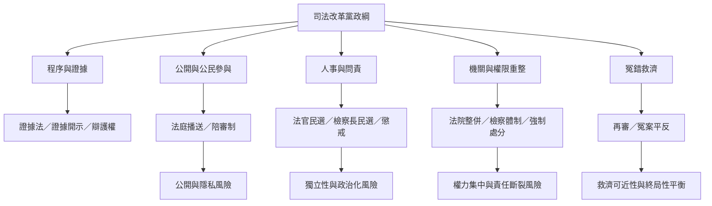

司法改革黨政綱可以依政策機制分成程序保障、資訊透明、公民參與、司法官問責、機關組織、檢察權配置與錯案救濟等群組。這種分群有助於識別提案間的互補與衝突。

核心連結：[[司法改革黨官方網站提出二十一項司法改革方案]]、[[司法改革政黨必須把制度不滿轉化為可檢驗的改革命題]]。

## 思與行
* 對每一群組邀請不同領域專家共同審查，避免以單一法律專業處理所有議題。
* 把可能互相矛盾的提案標記出來，例如增加人民選舉控制與維持裁判獨立之間的制度張力。

## 參考
* [[司法改革黨的政綱必須拆成可檢驗的制度命題]]。
* [[為司法改革黨二十一項政見製作公開政策風險矩陣]]。
* [[司法改革黨主席張靜於2026年參選高雄市長並以司法改革為政治主軸]]。
