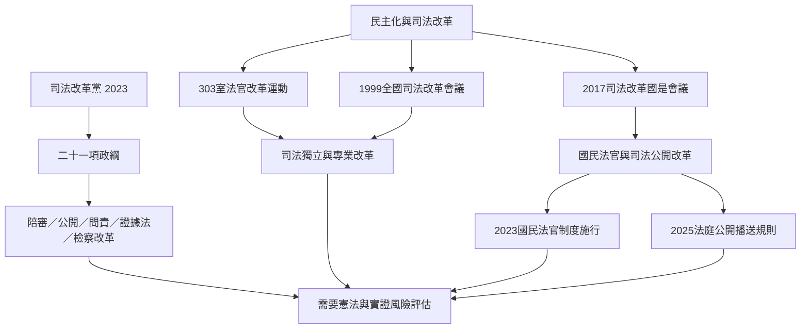

本圖把司法改革黨放回臺灣民主化後的司法改革歷史與當代政治競爭中理解。政黨成立與政綱是研究起點，不是整段改革史的唯一來源。

核心連結：[[臺灣司法改革不是單一政黨的歷史而是多方行動者的累積]]、[[司法改革黨的政綱必須拆成可檢驗的制度命題]]、[[內政部登記資料顯示司法改革黨於2023年成立並列為第382號政黨]]、[[司法改革黨官方網站提出二十一項司法改革方案]]。

## 思與行
* 以時間線持續補充1993、1999、2017、2020、2023、2025及2026年的關鍵制度事件。
* 對每項新政策標記它是歷史延續、改革重啟，還是政黨新增主張。

## 參考
* [[臺灣司法獨立改革曾由台中地院三零三室法官自內部推動]]。
* [[臺灣司法改革的歷史顯示制度移植必須回應民主化脈絡]]。
* [[國民法官法自2023年起讓一般公民參與特定刑事審判]]。
