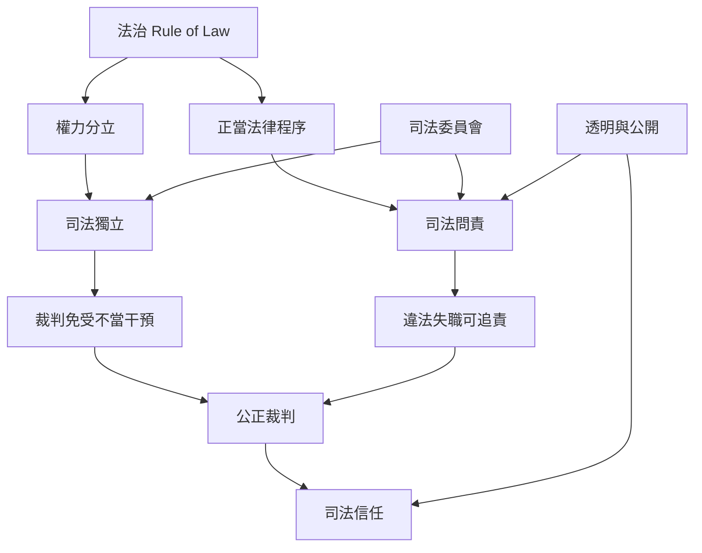

司法獨立、司法問責與法治不是互相排斥的價值，而是要透過制度相互支撐。問責需要程序保障，獨立需要透明治理，法治需要能有效救濟。

核心連結：[[司法獨立與司法問責必須同時被制度保障]]、[[司法問責不能以政治忠誠取代法律責任]]、[[司法改革的成功不能只用懲戒數量或辦案速度衡量]]。

## 思與行
* 每一項改革都同時測試它會不會提高問責，以及是否會增加政治干預風險。
* 以反向執政情境檢驗制度能否跨黨派維持。

## 參考
* [[聯合國司法獨立基本原則提供法院制度最低保障基準]]。
* [[威尼斯委員會法治檢核表將抽象法治轉化為可檢驗問題]]。
* [[司法委員會的獨立性取決於其組成與權限而非名稱]]。
