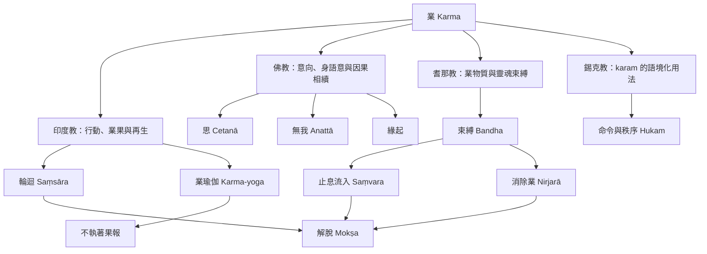

不同南亞傳統共享行動與後續處境之間的某種關聯，但對「行動者是誰」「業如何存在」「如何止息」有根本差異。印度教多元傳統常以靈魂、業果與輪迴討論解脫；佛教以意向、緣起與無我說明業的條件性；耆那教將業理解為束縛靈魂的物質。錫克教的 karam 又必須回到 hukam 與真實生活脈絡，不能直接納入同一公式。

## 概念連結
* [[業（Karma）]]是各傳統比較的起點。
* [[印度教業論同時談論倫理報果與性格養成]]、[[佛教業論以意向為核心，卻不等於只看主觀動機]]、[[耆那教把業理解為束縛靈魂的微細物質]]、[[錫克教的 karam 必須放回 hukam 與真實生活的脈絡理解]]分別呈現傳統差異。
* [[輪迴（Saṃsāra）]]與[[解脫（Mokṣa）]]串起業的宗教目的論。

[[Karma]]
