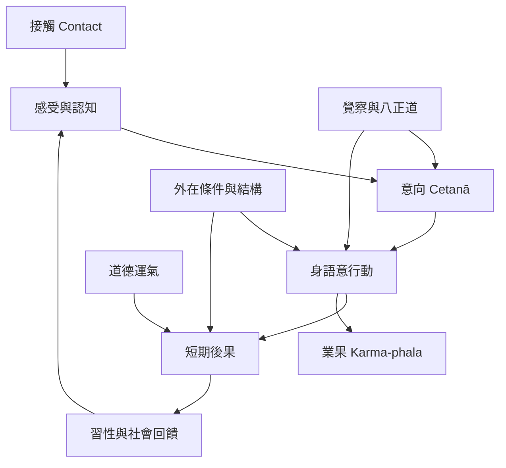

比較業論時，應將行動的起點、形成條件、過程與結果分開。佛教經典特別指出接觸、意向及身語意行動的關係；緣起提醒我們，行動不是單一原因的孤立產物。道德運氣則補充：實際結果有時取決於行動者無法控制的因素，因此責任判斷需要同時考量意圖與條件。

## 概念連結
* [[思（Cetanā）]]、[[業果（Karma-phala）]]、[[緣起（Pratītyasamutpāda）]]構成因果分析的概念骨架。
* [[佛教經典不支持把所有遭遇都解釋成宿業]]提醒多因一果。
* [[行動責任必須同時考量意圖、條件與實際後果]]連結道德運氣與行動修補。

[[Karma]]
