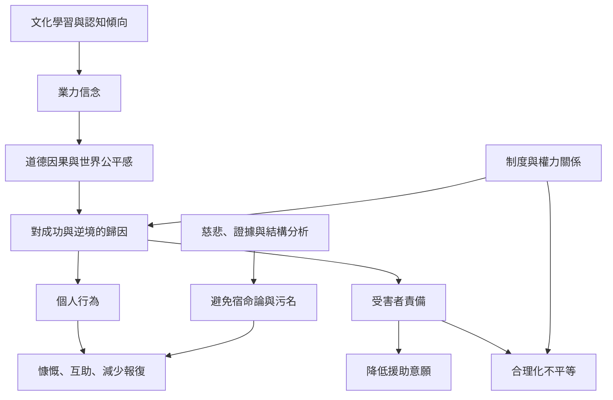

業力不只是一套宗教教義，也是人們解釋世界、判斷公平與決定是否援助他人的心理框架。它可能提供秩序感、鼓勵行善與減少報復；也可能把逆境歸咎於受害者，遮蔽制度性不平等。社會分析因此需要同時處理個人心理、宗教語言與權力結構。

## 概念連結
* [[業力信念是文化學習與認知傾向共同形塑的]]與[[跨文化研究顯示業力信念與正義觀及逆境歸因有關]]整理心理研究。
* [[業力信念可能帶來關懷，也可能合理化不平等]]與[[業論在社會制度中的實際效果必須接受權力分析]]整理社會效果。
* [[以多重因緣檢查取代「這是你的業」的快速判斷]]、[[把慈悲設為業力解釋的倫理檢核點]]提供實踐方向。

[[Karma]]
