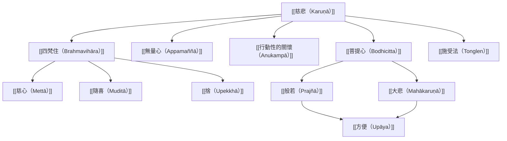

這張概念地圖整理佛教脈絡中慈悲的核心結構：早期佛教以四梵住與無量心培養悲心；行動性關懷使修習回到日常照顧；大乘佛教則以菩提心、般若與方便，擴展慈悲的願行範圍。

本圖不是把各傳統壓成一套固定階梯，而是標示常見的概念關聯。早期經典中的修習與大乘菩薩道之間存在歷史發展，不宜把後來術語回填成早期文本的原意。

## 思與行
* 依序閱讀四梵住、行動性關懷、菩提心與悲智雙運，留意每一層如何擴展慈悲的功能。
* 以實際修習經驗檢驗概念圖：慈悲是否與捨、智慧和具體行動互相支持？

## 參考
* [[早期經典呈現四梵住的遍滿修習與慈悲心解脫]]。
* [[牛津佛教慈悲綜述指出早期佛教與大乘佛教的重點差異]]。
* [[大乘以悲智雙運避免慈悲落入執著]]。
* [[佛教慈悲修習地圖從四梵住到悲智雙運]]。

書庫導讀：[[Karuṇā]]
