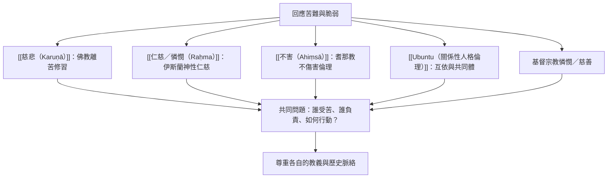

這張地圖以比較而非統一為目的。不同傳統有各自的經典、世界觀與修行方式：佛教慈悲、伊斯蘭仁慈、基督宗教憐憫、耆那教不害與 Ubuntu 關係倫理，都能參與關於苦難、責任與共同生活的對話，但不可直接互換。

## 思與行
* 比較時使用同一組提問，但不預設答案相同：苦的來源、倫理主體、關懷對象、修行方式與制度實踐。
* 把傳統內部的自我理解與外部學術分析並列，避免單向詮釋。

## 參考
* [[跨宗教比較應保留慈悲詞彙的文化與教義差異]]。
* [[伊斯蘭倫理中的raḥma涵蓋憐憫仁慈與養護性的關懷]]。
* [[耆那教的ahiṃsā把不傷害延伸到多種生命形式]]。
* [[全球慈悲倫理地圖比較不同傳統的關懷語彙]]。

書庫導讀：[[Karuṇā]]
