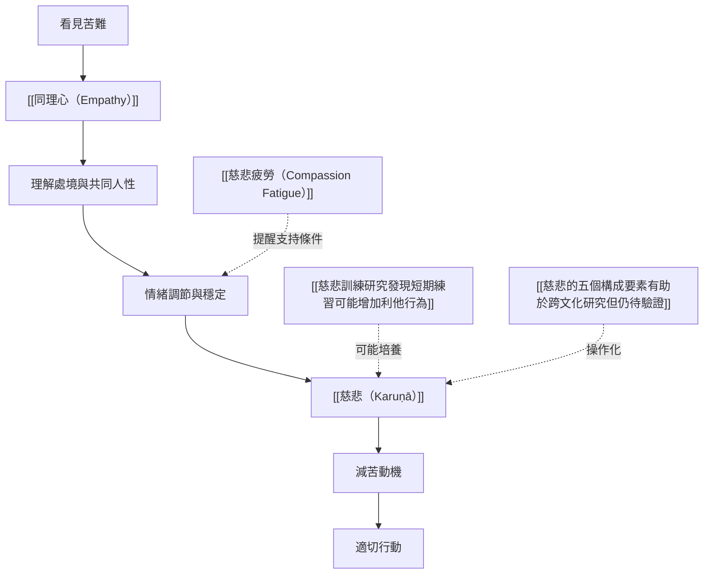

這張地圖把慈悲作為心理歷程來閱讀：辨識苦難與同理心可能提供線索，但慈悲還包括調節情緒、承受不適、形成減苦動機與採取行動。研究可以檢驗部分環節，卻不能以單一量表或腦區活化代表慈悲全貌。

## 思與行
* 研究或課程設計要區分情緒共振、慈悲動機與實際行為。
* 把照護者支持納入模型，避免把情緒調節責任全部推給個人。

## 參考
* [[同理心與慈悲在心理學上相連但並不相同]]。
* [[慈悲不等於吸收他人的痛苦]]。
* [[慈悲的測量工具只能捕捉經驗的一部分]]。
* [[慈悲心理科學地圖從覺察共感到減苦行動]]。

書庫導讀：[[Karuṇā]]
