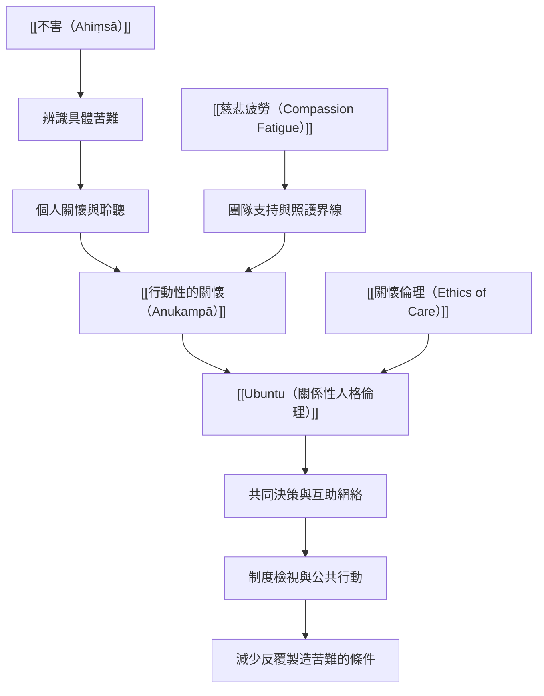

慈悲若要持續回應真實苦難，需要同時看見個人、關係、社區與制度。這張地圖把聆聽和直接照護，連結到共同體互助、受影響者參與、制度改善與團隊可持續性。

## 思與行
* 為任何服務或倡議同時畫出個人、社區與制度三層行動。
* 讓受影響者共同定義需要與評估成效，並提供安全拒絕的權利。
* 把助人者的休息、人力與支持列入制度設計。

## 參考
* [[慈悲不能替代改善不公制度的責任]]。
* [[慈悲實踐應讓受影響者參與定義需要]]。
* [[慈悲需要邊界與可持續的照顧安排]]。
* [[慈悲社會實踐地圖從個人照護到結構正義]]。

書庫導讀：[[Karuṇā]]
