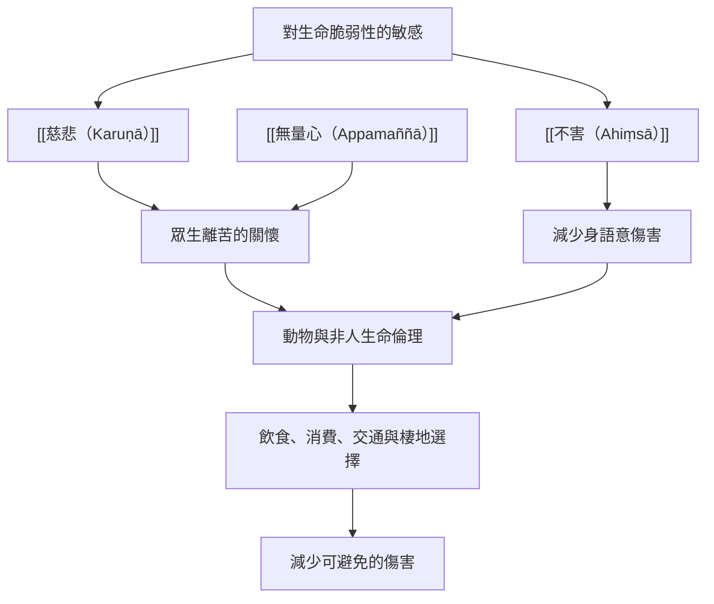

此圖聚焦慈悲的關懷對象如何超出人類。佛教的眾生關懷與耆那教的不害，對生命範圍有各自的宗教哲學理解；當代生態與動物倫理可與之對話，但應避免把不同的生命觀與科學分類混為一談。

## 思與行
* 從生活方式的實際影響開始，不把不害變成道德純潔競賽。
* 將宗教世界觀、動物倫理研究與生態科學分開閱讀，再進行有界線的比較。

## 參考
* [[慈悲的關懷對象可以包含非人生命]]。
* [[耆那教的ahiṃsā把不傷害延伸到多種生命形式]]。
* [[把非人生命納入日常慈悲的微型觀察]]。
* [[慈悲與非人生命地圖從不害到生態關懷]]。

書庫導讀：[[Karuṇā]]
