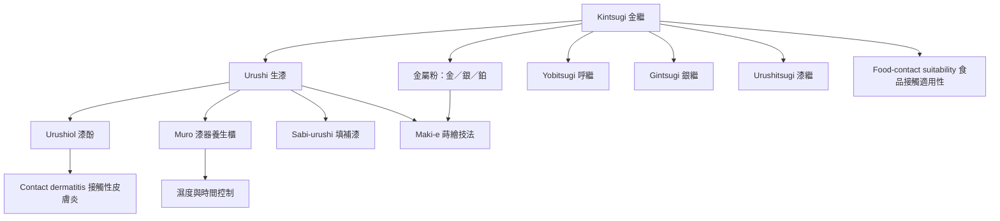

金繼的材料系統以生漆為核心，結合黏合、填補、濕度養生、研磨與金屬粉裝飾。不同工法的差異，能幫助我們區分傳統工藝、修復用途與當代仿作。

## 思與行
* 由材料向工序閱讀：[[Urushi]] → [[Muro]] → [[Sabi-urushi]] → [[Maki-e]]。
* 操作安全與食用用途分開理解：[[Urushiol]]、[[Contact dermatitis]]、[[Food-contact suitability]]。
* 進一步閱讀：[[傳統金繼以生漆黏合並透過濕度與時間完成硬化]]、[[傳統金繼與仿金繼應依材料與工序清楚區分]]。

## 參考
* [[金繼的確切起源不明但十六世紀已與茶道器物密切相連]]；[[日本漆膜研究顯示硬化與劣化都受濕度和光照條件影響]]。
