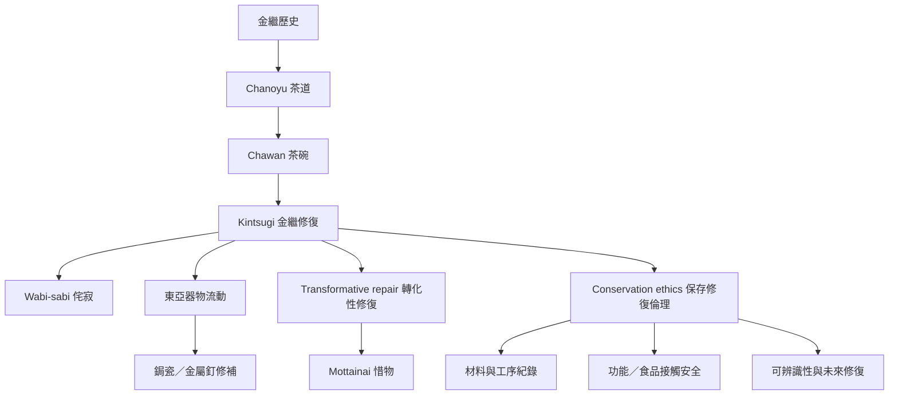

金繼形成於日本漆藝與器物修復脈絡，並與茶道、茶碗收藏及東亞陶瓷流通相連。當代修復倫理則要求把器物來源、材料改變、用途、安全及未來保存一併考慮。

## 思與行
* 以器物生命史閱讀金繼：產地、使用、破損、修復和收藏可能分別發生在不同地域。
* 比較「延長使用」與「保存文化財」兩種修復目標，理解它們不一定採取相同做法。
* 進一步閱讀：[[金繼的歷史應從亞洲陶瓷流動和茶道關係共同理解]]、[[金繼修復不等於把器物恢復成從未破損的原狀]]。

## 參考
* [[金繼的確切起源不明但十六世紀已與茶道器物密切相連]]；[[史密森尼亞洲藝術館的修復標籤說明金繼工序如何重建缺口]]；[[V&A資料將金繼放入全球修補文化而非孤立的日本奇觀]]。
