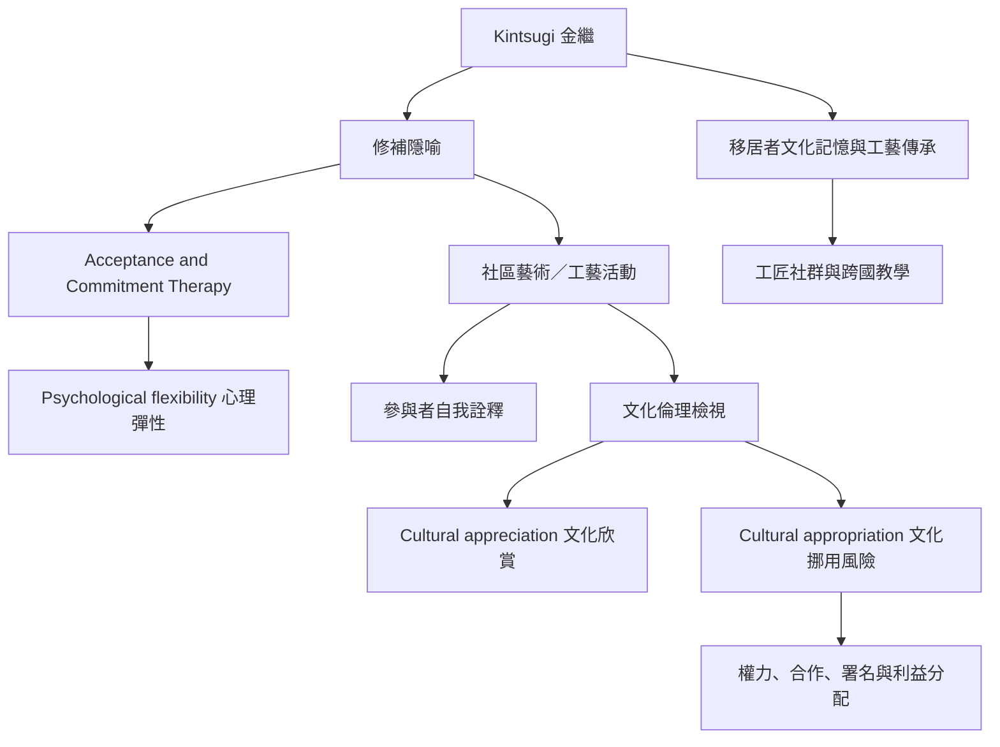

金繼在當代被延伸為修復、接納和心理彈性的隱喻，也進入藝術工作坊和跨文化活動。這些應用可能帶來創作與對話機會，但必須保留研究證據的限制，並檢視文化知識與權力關係。

## 思與行
* 把金繼作為比喻時，保留參與者不談創傷、不追求正向結局的權利。
* 以 2026 年質性研究作為探索線索，不將 9 人訪談轉化成臨床療效宣稱。
* 以工藝師參與、合理報酬與共同決策落實跨文化倫理。

## 參考
* [[金繼與接納承諾療法的研究目前只能支持探索性質性理解]]；[[文化挪用研究指出金繼藝術介入需評估權力與合作關係]]；[[美國史密森尼工藝駐村呈現金繼作為日本離散文化連結的方式]]。
