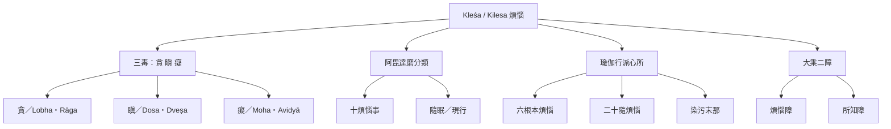

煩惱不是單一清單，而是不同傳承用來分析心行、束縛與修道的分類工具。此圖把三毒、上座部論書、瑜伽行派及大乘二障放在同一張地圖上，但保留其歷史與教義差異。

[[Kleśa]] [[Kilesa]] [[Lobha]] [[Dosa]] [[Moha]] [[Anusaya]] [[Paryavasthāna]] [[Upakleśa]] [[Kliṣṭa-manas]] [[Kleśāvaraṇa]] [[Jñeyāvaraṇa]]

## 思與行
* 讀資料時先標記它屬於哪一傳承，再把術語放入圖中；必要時保留一詞多義。

## 參考
* [[上座部阿毘達摩以十種煩惱事整理不善心]]
* [[部派阿毘達摩區分潛伏煩惱與現行煩惱]]
* [[瑜伽行派分析染污末那如何塑造自我感]]
* [[大乘以煩惱障與所知障區分解脫與遍知障礙]]
