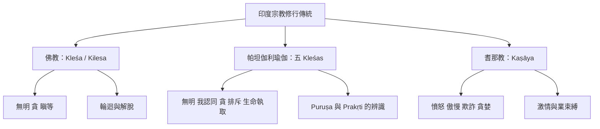

Kleśa、kilesa 與 kaṣāya 在佛教、瑜伽及耆那教脈絡中都涉及心的染著與束縛，但其靈魂觀、心識理論、業論與解脫目標並不相同。比較時應先說明各自語境，再找出有限的功能相似性。

[[Kleśa]] [[Kilesa]] [[Kaṣāya]] [[Avidyā]] [[Asmitā]] [[Rāga]] [[Dveṣa]] [[Abhiniveśa]]

## 思與行
* 比較時分別回答「問題是什麼」「人如何被束縛」「解脫是什麼」「如何對治」，不要只比較詞彙。

## 參考
* [[帕坦伽利以五種煩惱解釋瑜伽修行障礙]]
* [[耆那教以四種激情說明業的束縛]]
* [[瑜伽五煩惱與佛教三毒只有部分交集]]
