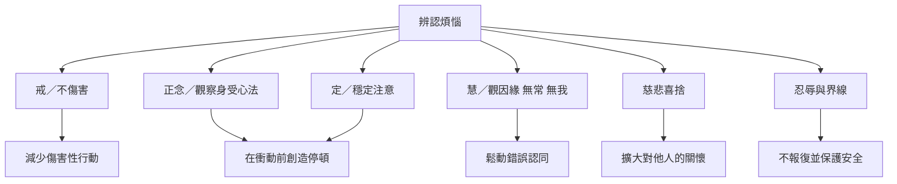

煩惱的對治不是單一技巧。不同傳統會結合倫理行為、感官防護、正念、定力、智慧、忍辱與慈悲；這張圖呈現可互相支持的修習資源，並非宣稱不同宗派的修道論完全相同。

[[Satipaṭṭhāna]] [[Brahmavihāra]] [[Kṣānti]] [[Kriyā-yoga]] [[Bodhicitta]] [[Sīla]] [[Samādhi]] [[Paññā]]

## 思與行
* 選擇一項反覆發作的煩惱，同時安排一個行為層面、一個注意力層面與一個智慧觀照層面的練習。

## 參考
* [[《布經》列舉心的十六種染污並提出捨離方法]]
* [[寂天以忍辱與緣起論證對治瞋怒]]
* [[2024年研究從布經整理日常對治煩惱的方法]]
