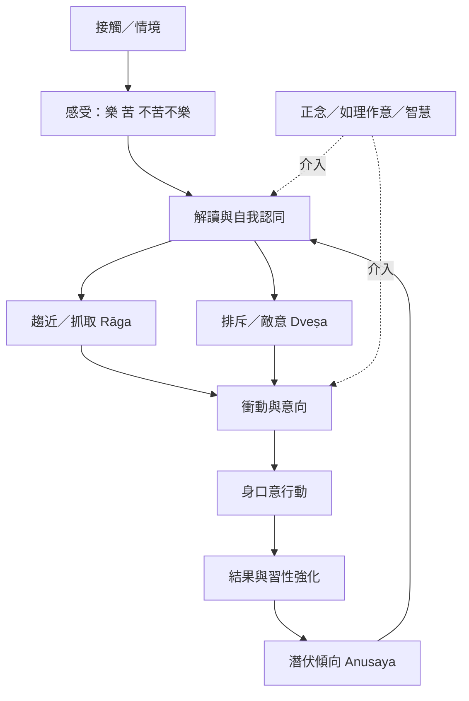

這張圖將煩惱理解為依條件形成的反應過程：接觸與感受提供觸發，過去習性與錯誤認知影響評估，接著形成抓取或排斥的衝動，最後可能透過行動再度強化習性。這是幫助觀察的工作模型，不是所有佛教傳統共同採用的單一教義圖。

[[Vedanā]] [[Taṇhā]] [[Anusaya]] [[Paryavasthāna]] [[Avidyā]] [[Rāga]] [[Dveṣa]] [[Satipaṭṭhāna]]

## 思與行
* 使用此圖分析真實事件，分清楚可觀察事實與自動解讀。

## 參考
* [[部派阿毘達摩區分潛伏煩惱與現行煩惱]]
* [[貪與瞋沿著趨樂避苦形成相互依存的反應]]
* [[將反應拆成感受判斷衝動行為鏈]]
