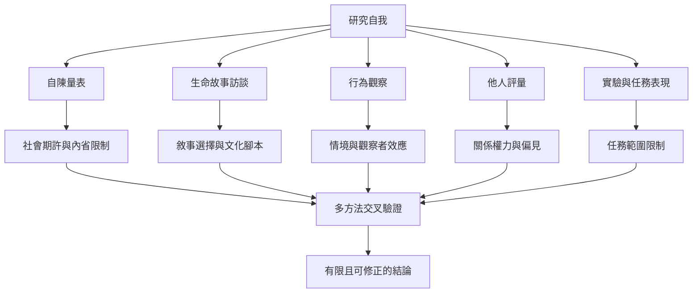

自我研究可用質性訪談、日記、行為觀察、量表與元認知任務等方法；每種方法測量不同構念。研究者還必須處理文化樣本偏誤、測量效度、社會期許與權力不對等。

連結：[[自我認識需要行為觀察與他人回饋補足內省]]、[[生命故事訪談提供研究自我敘事的具體方法]]、[[WEIRD樣本警告自我研究不可直接泛化至全人類]]、[[2026年系統性回顧提醒自我認識準確度不等於心理適應]]。

本書導讀：[[Know_thyself]]。
