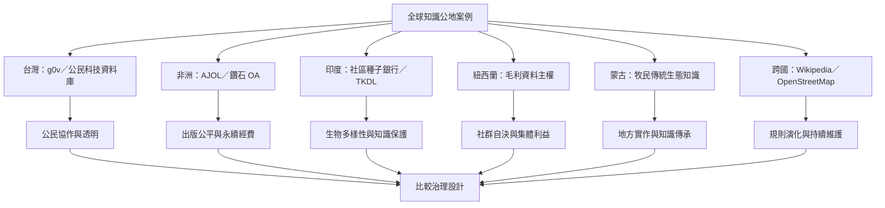

不同地區的知識公地依資源類型和社群脈絡而有差異。這張圖將台灣公民科技、非洲學術出版、印度種子銀行、毛利資料主權、蒙古牧民知識與全球數位平台放入共同比較框架。

概念連結：
* [[g0v 案例呈現開源社群如何將公民知識轉化為公共行動]]
* [[非洲鑽石開放取用期刊展現不向作者與讀者收費的學術模式]]
* [[印度社區種子銀行把種子保存與農民知識交流連在一起]]
* [[毛利資料主權將資料視為關係與集體責任的一部分]]
* [[蒙古牧民的傳統生態知識需要在當代制度中被翻譯]]
* [[維基百科規則是持續協商的社群產物]]
* [[OpenStreetMap 顯示開放地理資料需要授權與持續維護]]
