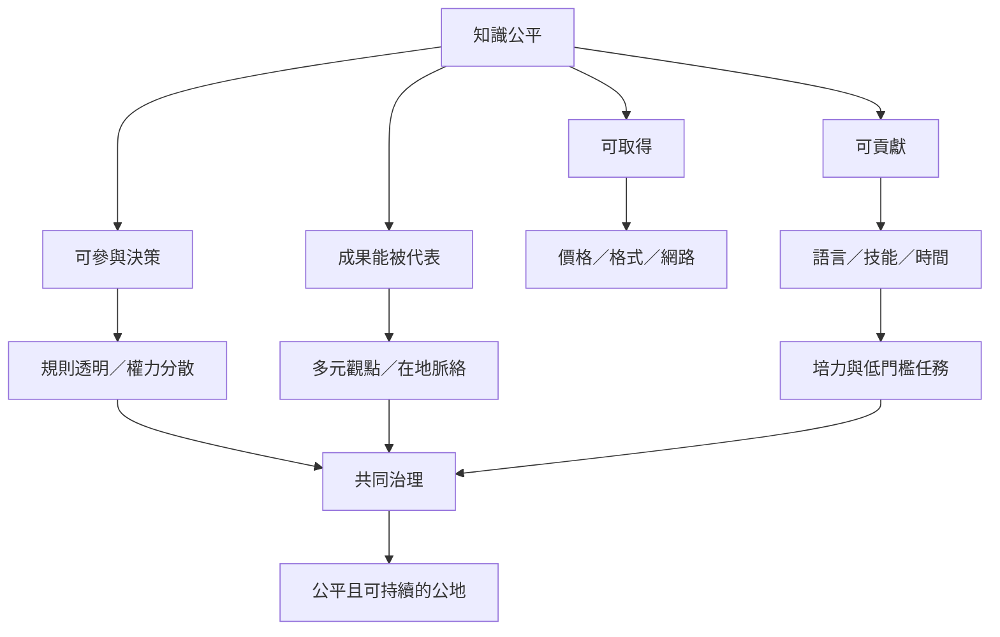

知識公平同時涵蓋取得知識、貢獻知識、設定規則和影響成果。若參與門檻高或維護成本分配不均，形式開放仍可能延續不平等。

概念連結：
* [[知識公平 Knowledge equity]]
* [[數位落差 Digital divide]]
* [[多語知識公地需要讓地方語言成為知識生產語言]]
* [[同儕生產 Peer production]]
* [[知識公地的評估應同時觀察成果公平與治理過程]]
