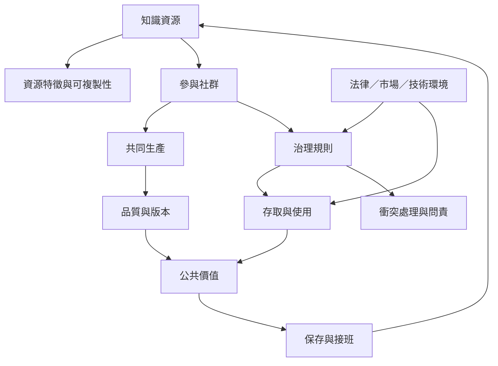

知識公地的分析單位不是孤立資料，而是資源、參與者、規則、基礎設施和外部環境構成的整體。這張圖從知識資源出發，連到社群生產、治理、使用與維護。

概念連結：
* [[知識公地 Knowledge commons]]
* [[知識公地分析框架 Knowledge commons framework]]
* [[知識基礎設施 Knowledge infrastructure]]
* [[共同治理 Commoning]]
* [[公地維護 Stewardship]]
