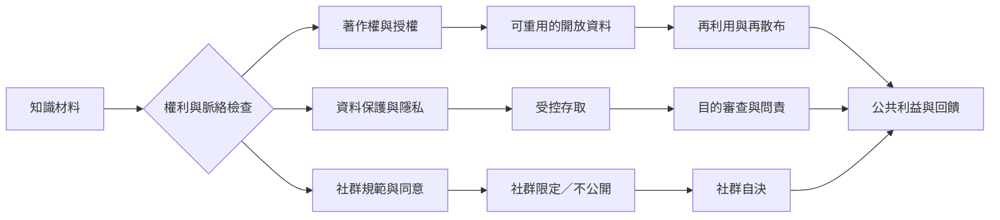

知識開放不是單一開關。法律授權、技術可取得、社群同意、資料倫理和使用情境必須一起考量；有些知識應公開，有些應受限制。

概念連結：
* [[開放知識 Open knowledge]]
* [[開放授權 Open licensing]]
* [[公有領域 Public domain]]
* [[CARE 原則 CARE principles]]
* [[TK 標籤 TK Labels]]
* [[知識公地應讓地方社群保有拒絕公開與限制使用的權利]]
