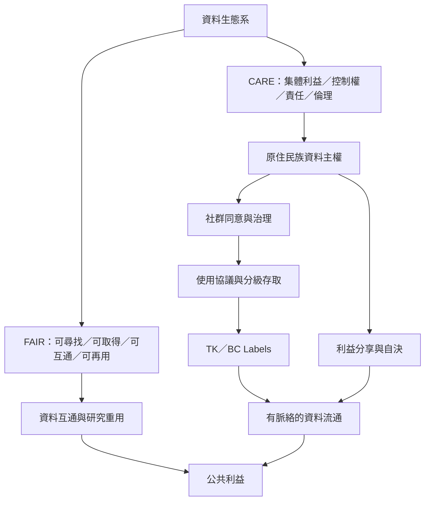

資料公地需要在資料可再利用與資料主體的權利之間建立治理。FAIR 偏重資料管理與再利用條件，CARE、毛利資料主權與 TK Labels 將社群控制和文化脈絡帶回制度設計。

概念連結：
* [[資料公地 Data commons]]
* [[FAIR 原則 FAIR principles]]
* [[CARE 原則 CARE principles]]
* [[原住民族資料主權 Indigenous data sovereignty]]
* [[毛利資料主權 Māori data sovereignty]]
* [[TK 標籤 TK Labels]]
