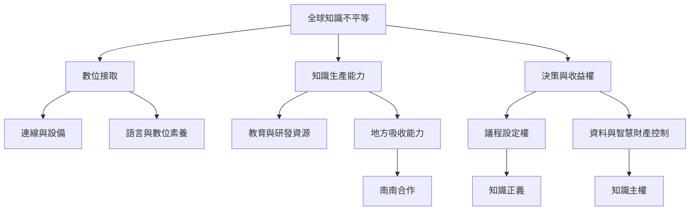

全球知識不平等不只是網路接取問題，還包括算力、資料、資金、語言、制度、人才與治理代表性。即使知識可在線上取得，不同社群仍可能缺乏把知識轉為自主能力的條件。

可連結[[數位落差會累積成知識生產與收益分配的落差]]、[[全球南方的知識經濟不能只用產業升級衡量創新]]及[[AI發展中的全球差距源自基礎設施資料與技能集中]]。

## 相關概念
[[數位落差]]、[[AI落差]]、[[知識正義]]、[[知識主權]]、[[吸收能力]]、[[人力資本]]、[[全球南方]]、[[數位素養]]、[[認識不正義]]、[[知識生產]]、[[發展型國家]]。
