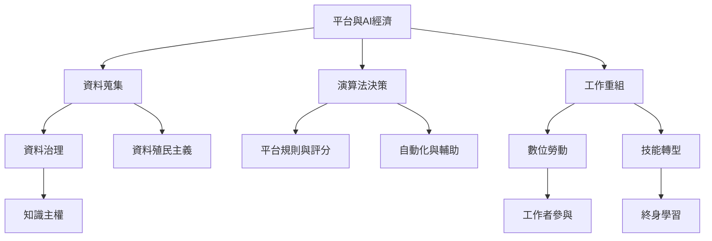

平台和 AI 系統將日常活動轉成資料，並重新分配工作、知識與決策權。問題不只在技術是否提升效率，也在資料由誰控制、勞動如何被組織、錯誤由誰承擔，以及收益是否回到知識提供者。

延伸閱讀[[平台治理決定知識資料如何被擷取與分配]]、[[數位知識生產依賴常被隱形化的勞動]]和[[AI時代的知識收益分配取決於政治制度而非技術本身]]。

## 相關概念
[[平台經濟]]、[[資料治理]]、[[資料殖民主義]]、[[數位勞動]]、[[人工智慧]]、[[AI落差]]。
