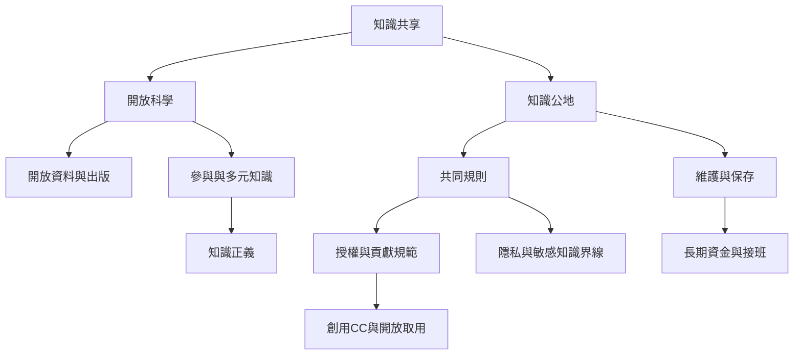

開放科學和知識公地都追求知識共享，但持續共享需要治理規則、資金、維護者、保存和公平參與。開放不是把所有限制撤除，而是以公共利益為方向，設計透明且合乎倫理的使用制度。

延伸閱讀[[知識公地需要共同治理而非只靠免費開放]]、[[開放若沒有能力建置與公平參與仍可能擴大知識不平等]]、[[開放知識需要維護與保存制度]]。

## 相關概念
[[知識公地]]、[[開放科學]]、[[開放取用]]、[[創用CC]]、[[智慧財產權]]、[[知識管理]]。
