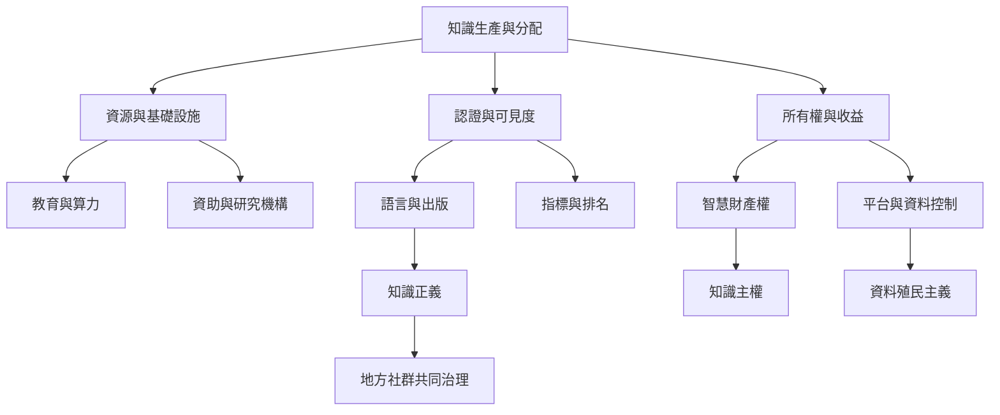

知識不是在真空中流動。研究資助、語言、學術出版、智慧財產、平台規則和人才流動會決定誰能生產知識、誰能被認證、誰控制成果，以及誰取得收益。本圖將全球權力與在地知識主體放進同一個分析框架。

可對照[[知識經濟的全球分布受歷史權力關係塑造]]、[[知識正義要求不同社群能參與定義問題]]與[[產業升級不必然代表知識自主或創新能力]]。

## 相關概念
[[知識正義]]、[[知識主權]]、[[資料殖民主義]]、[[智慧財產權]]、[[數位落差]]、[[原住民族知識]]。
