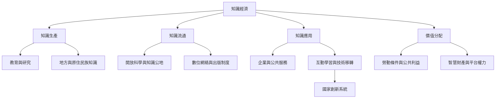

知識經濟不是單一產業，而是一個由知識生產、教育與技能、創新制度、資訊基礎設施、組織學習和價值分配組成的系統。此圖把經濟活動的條件與結果放在同一張圖中，避免把知識等同於專利或科技產品。

此圖與[[知識經濟的價值來自社會化的知識能力而非單一高科技產業]]、[[創新是互動學習而非孤立發明]]及[[知識經濟的衡量方式會決定哪些知識被看見]]互相補充。

## 相關概念
[[知識經濟]]、[[知識]]、[[人力資本]]、[[學習經濟]]、[[國家創新系統]]、[[知識管理]]。
