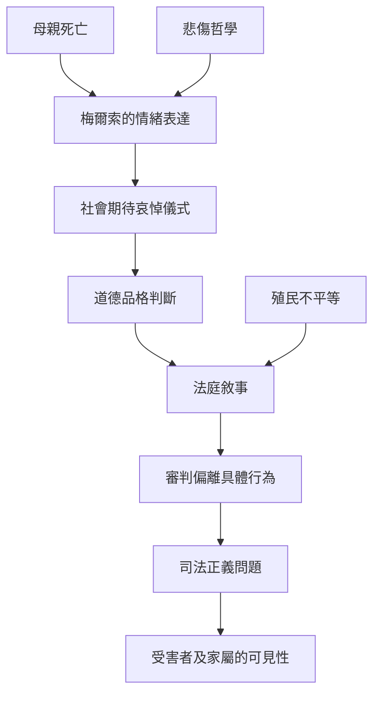

此地圖聚焦母親葬禮、戀愛、神父對話與法庭審判，分析社會如何透過情緒表現判斷一個人的道德身分。情緒規範可能遮蔽具體行為與受害者，但批判規範也不代表取消行為責任。

概念連結：[[term/情感規範]]、[[term/哀悼]]、[[term/司法正義]]、[[term/倫理責任]]。

相關永久筆記：[[note/社會常規把可見的哀悼誤當成愛與道德的證明]]、[[note/情感規範會讓司法審判偏離具體行為]]、[[note/真誠不會自動替行為提供道德正當性]]。

雙向連結：[[moc/異鄉人的四條閱讀路徑]]、[[moc/荒謬、身體與真誠]]。
