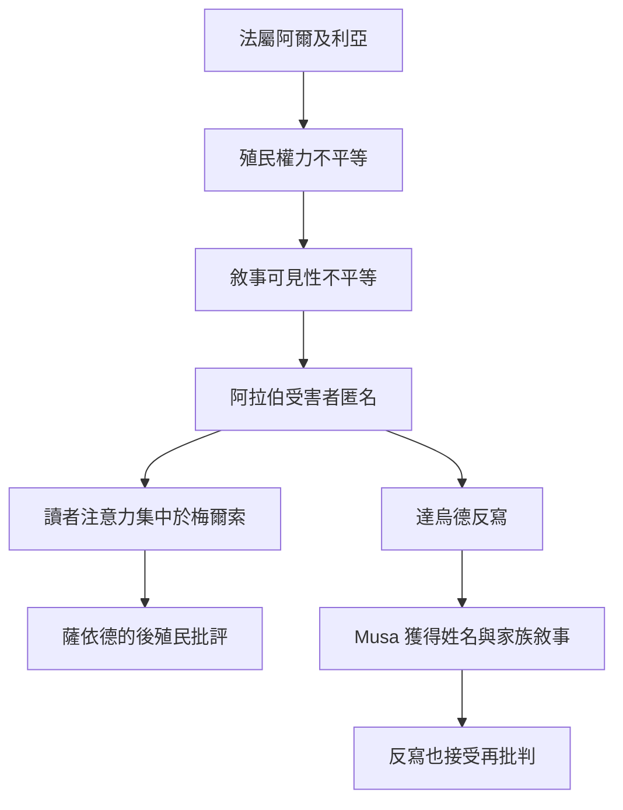

此地圖把小說的阿爾及利亞場景、殖民權力、敘事焦點與後來的反寫放在同一個問題網絡中：誰被命名、誰能說話、誰的生活被描寫，會影響讀者如何理解暴力與正義。

概念連結：[[term/法屬阿爾及利亞]]、[[term/殖民凝視]]、[[term/後殖民批評]]、[[term/後殖民改寫]]、[[term/命名政治]]。

相關永久筆記：[[note/殖民凝視使阿拉伯受害者在小說中缺席]]、[[note/阿爾及利亞殖民背景改變了小說中審判的政治意義]]、[[note/閱讀卡繆必須同時保留其反暴力立場與殖民盲點]]、[[note/達烏德的反寫讓匿名受害者成為敘事中心]]、[[note/殖民敘事的修補也可能產生新的權力盲點]]。

雙向連結：[[moc/異鄉人的四條閱讀路徑]]、[[moc/翻譯、接受史與世界文學]]。
