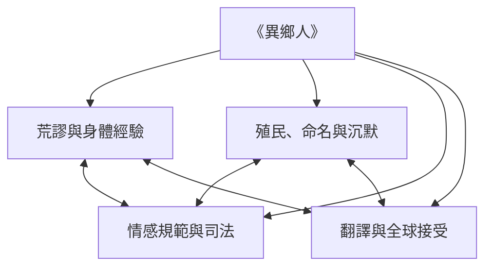

《異鄉人》可以同時作為荒謬哲學小說、殖民地敘事、情感與司法批判，以及世界文學翻譯案例來讀。四條路徑彼此連結，不必競爭唯一正解：哲學路徑問人如何面對世界的沉默；殖民路徑問誰獲得完整的敘事主體性；情感司法路徑問社會如何規訓個人；接受史路徑問作品如何在不同語言與制度中被重新理解。

雙向連結：[[moc/荒謬、身體與真誠]]、[[moc/殖民、命名與敘事沉默]]、[[moc/情感規範、審判與責任]]、[[moc/翻譯、接受史與世界文學]]。
