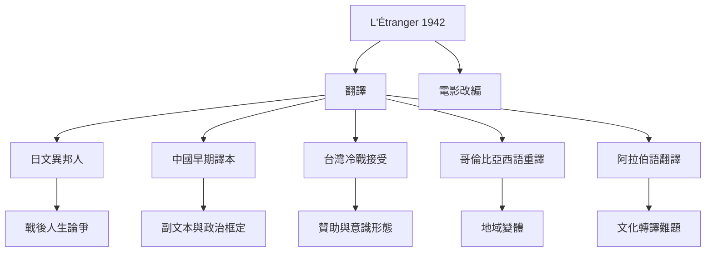

此地圖追蹤《異鄉人》從法國出版後，如何透過翻譯、出版制度、評論與改編進入不同社會。日本、中國、台灣、哥倫比亞與阿拉伯語翻譯研究顯示，語言與制度不只是傳播渠道，也會重塑讀者遇見作品的方式。

概念連結：[[term/文學翻譯]]、[[term/副文本]]、[[term/接受史]]、[[term/世界文學]]、[[term/電影改編]]。

相關永久筆記：[[note/翻譯標題與出版副文本會重塑讀者進入作品的方式]]、[[note/不同社會會把同一部小說讀成不同的生活問題]]、[[note/改編作品會重新分配敘事者與觀眾的觀看位置]]。

雙向連結：[[moc/異鄉人的四條閱讀路徑]]、[[moc/殖民、命名與敘事沉默]]。
