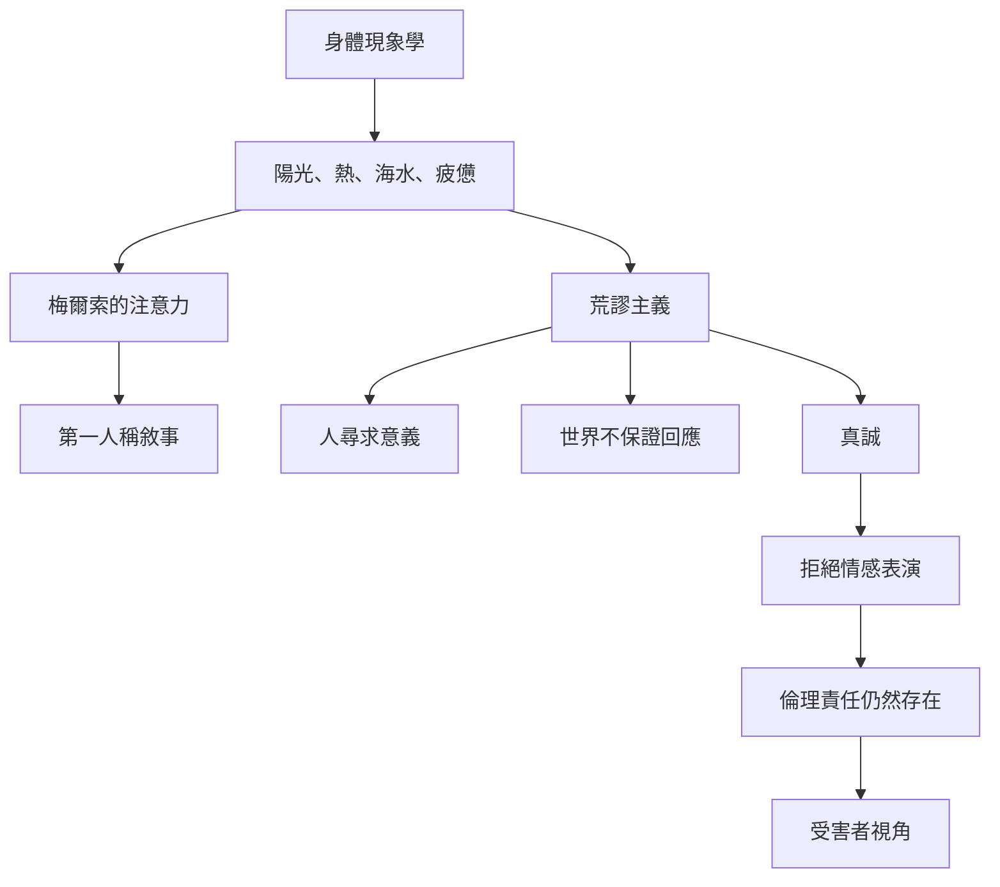

此概念地圖將卡繆的荒謬思想與梅爾索的感官經驗、敘事形式及真誠倫理連結。荒謬不是虛無；身體讓抽象問題落在具體生活中；但真誠不能替傷害行為免責。

概念連結：[[term/荒謬主義]]、[[term/存在主義]]、[[term/身體現象學]]、[[term/倫理責任]]、[[term/第一人稱敘事]]。

相關永久筆記：[[note/荒謬不是虛無而是人與世界之間的張力]]、[[note/身體感官的強烈存在使梅爾索不能簡化成無情的人]]、[[note/梅爾索拒絕表演社會期待的情緒因此成為異鄉人]]、[[note/真誠不會自動替行為提供道德正當性]]。

雙向連結：[[moc/異鄉人的四條閱讀路徑]]、[[moc/情感規範、審判與責任]]。
