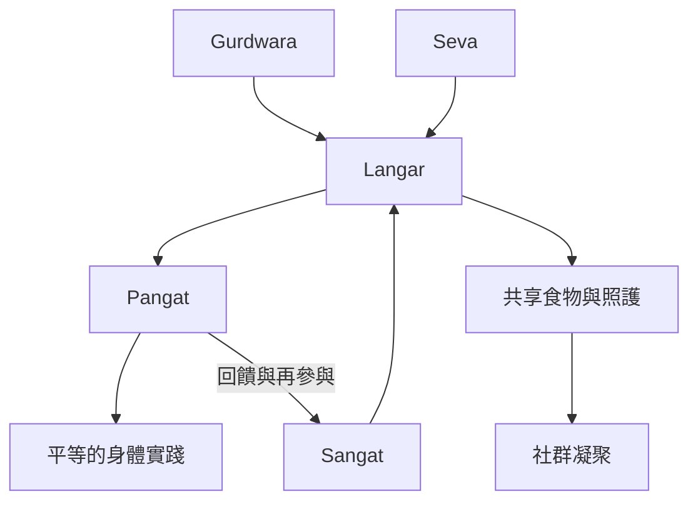

Langar 的核心結構可由宗教場域、會眾聚集、志願服務與共同進食四個面向理解。Gurdwara 提供場域，Sangat 形成會眾，Seva 組織共同勞動，Pangat 則把共同體的平等理想落在用餐現場。

## 概念連結
* [[Langar]] · [[Pangat]] · [[Sangat]] · [[Seva]] · [[Gurdwara]] · [[Vand Chhako]]

## 深入筆記
* [[Langar 是宗教制度而不只是免費餐食]]
* [[Pangat 以身體並坐把平等變成可見秩序]]
* [[Sangat 與 Langar 共同構成社群生活的兩個面向]]

## 參考
* [[《Oxford Handbook of Sikh Studies》中的錫克教制度章節提供理解 Langar 的宗教制度脈絡]]；[[旁遮普百科對 Pangat 的說明將共食、平等與 Sangat 連結]]。
