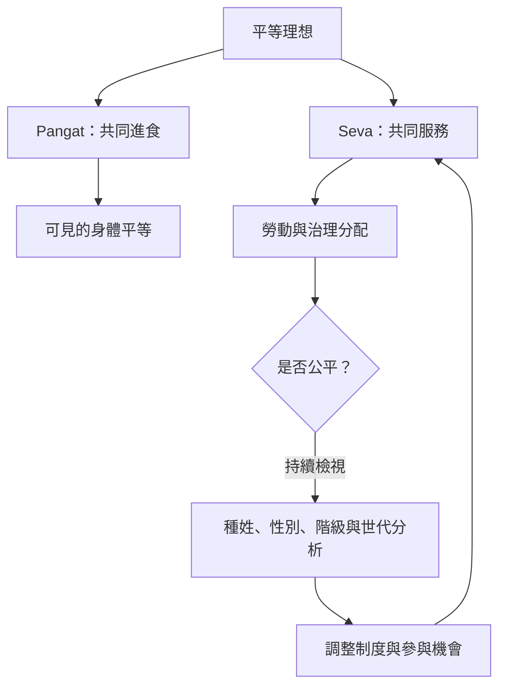

Langar 的平等價值需要同時從用餐秩序與勞動秩序檢驗。共同進食能挑戰身分區隔，但社群中的種姓與性別關係仍可能影響決策權、勞動分配與公共能見度。

## 概念連結
* [[Pangat]] · [[Seva]] · [[Sangat]] · [[Commensality]]

## 深入筆記
* [[共同用餐可以挑戰階序卻不會自動消除種姓制度]]
* [[平等的公共儀式仍可能依賴不平等的勞動分工]]
* [[Langar 的平等承諾必須延伸到服務工作的分配]]

## 參考
* [[Nicola Mooney 的研究提醒錫克平等理想與種姓性別現實之間存在落差]]；[[義大利錫克女性研究揭示 Seva 與 Langar 廚房中的性別化勞動]]。
