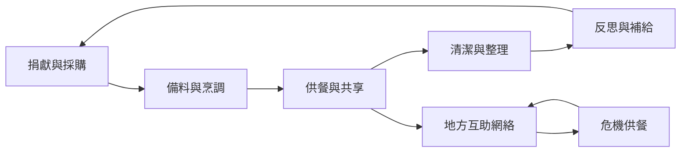

Langar 的持續運作依賴物資、勞動、治理與地方網絡。這張圖將一餐從資源募集到餐後清潔的服務鏈，連接到公共互助與危機應變。

## 概念連結
* [[Seva]] · [[Langar]] · [[Gurdwara]] · [[Vand Chhako]]

## 深入筆記
* [[Seva 的價值應包括照護勞動者而不只計算服務成果]]
* [[既有 Langar 網絡能在災難中快速轉化為互助基礎設施]]
* [[Langar 在離散社群中兼具供餐與社群接待功能]]

## 參考
* [[印度 Goa 的疫情封鎖案例顯示 Gurdwara 志願者如何轉為緊急供餐網絡]]；[[UNITED SIKHS 於曼哈頓的 Langar Seva 展示宗教服務的城市延伸]]。
